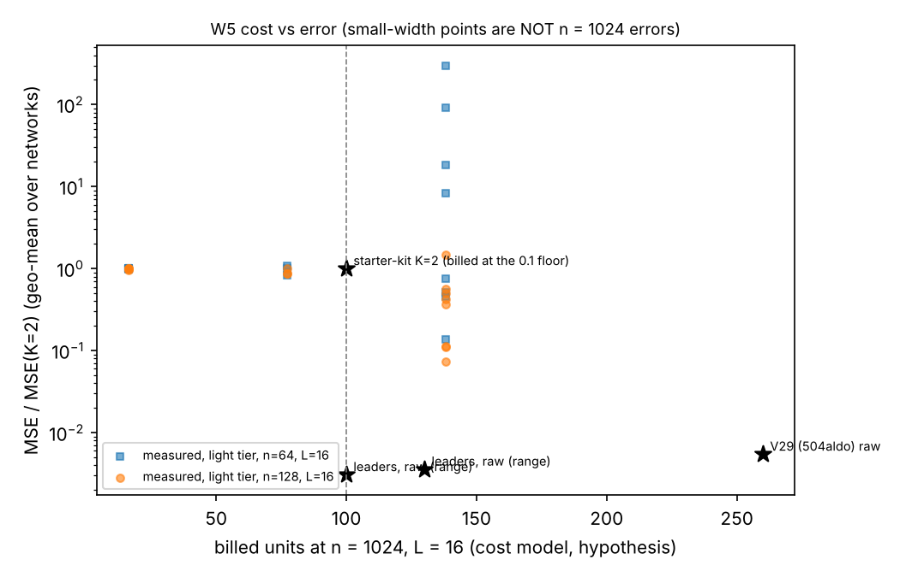

# W5 — measured, cost-aware diagram selection (2026-10-17)

> LLM-generated record (Claude Code) for team Arieb-007. Runner `experiments/w5_selection.py`, aggregation
> `experiments/w5_report.py`, registry `results/2026-10-17_w5_term_registry.md`, cost model
> `docs/notes/w5_cost_model.md` (**a hypothesis** calibrated on one external point, V29).
> Weights W ~ N(0, 2/n) from `default_rng(seed)`; MC truth N = 4e6 per network, MC seed 70000 + 100 L + seed
> (cached in data/mc); MSE = debiased final-layer MSE (MC floor subtracted).

**Falsifier (written before running).** The selection does not transfer across widths if the Spearman rank
correlation of leave-one-out effects between n = 128 and n = 256 (light tier, L = 16) is < 0.7; then a
selection made at small width is not evidence for n = 1024.

**Design change (recorded before the runs below).** The first design (groups of terms by output order and
input family, dense K=4 cap-3 tier at n = 64, L = 16) was abandoned after two networks: (i) a group that
only WRITES state is inert when added to the K=2 base (ADD effect identically 0), and (ii) the full dense
K=4 cap-3 set is itself unstable at n = 64, L = 16 (MSE 8.1e-3 on seed 0 vs 1.6e-3 for K=2; removing
groups gave MSE up to 3e4). Raw data kept in data/w5_groups_v1/. Features are now the input slices a
term READS (a term is on iff all slices it reads are on); the dense tier is run at L = 8, where the
full set is stable; the transfer test uses the light tier (K ≤ 3 dense + coherent κ4), which is what
an n = 1024 implementation could afford.

Features: `Cpair` = covariance-only diagrams with ≥ 2 edges on mean/covariance (c², c³ corrections);
`K3(s)` / `K4(s)` = terms reading that cumulant slice of the pre-activation (light tier: K4 slices are the
coherent O(n²) values); `cap3` = all cost-3 (order n^-3/2) diagrams. All on = DenseProp(4, cap 3) or
CoherentEvenProp('coherent', cap 3); all off = K=2 (tests/test_w5.py checks these identities exactly).

## Tier dense, n = 64, L = 8: 10 networks (seeds 0–9)

All features: MSE 1.259e-05 [8.56e-06, 1.79e-05] (0 diverged); K=2 base: 5.554e-04 [4.08e-04, 7.07e-04]; mean log(full/base) = -3.83; mean MC floor 5.5e-08.

| feature | LOO mean [95% CI] | MDE | LOO div. | ADD mean [95% CI] | ADD div. | billed units of base+f |
|---|---|---|---|---|---|---|
| Cpair | +0.941 [+0.746, +1.148] | 0.299 | 0 | -0.015 [-0.051, +0.020] | 0 | 16 |
| K3(3,) | +3.870 [+3.633, +4.120] | 0.366 | 0 | +0.354 [+0.206, +0.498] | 0 | 77 |
| K3(2,1) | +3.582 [+3.316, +3.886] | 0.430 | 0 | +0.274 [+0.051, +0.506] | 0 | 138 |
| K3(1,1,1) | +2.172 [+1.968, +2.388] | 0.319 | 0 | +0.000 [+0.000, +0.000] | 0 | 77 |
| K4(4,) | +0.977 [+0.801, +1.156] | 0.270 | 0 | -0.002 [-0.035, +0.033] | 0 | 382 |
| K4(2,2) | +2.006 [+1.683, +2.301] | 0.458 | 0 | +0.015 [-0.003, +0.031] | 0 | 382 |
| K4(3,1) | +1.654 [+1.413, +1.934] | 0.397 | 0 | +0.000 [+0.000, +0.000] | 0 | 382 |
| K4(2,1,1) | +2.166 [+1.947, +2.390] | 0.336 | 0 | +0.000 [+0.000, +0.000] | 0 | 382 |
| K4(1,1,1,1) | +0.318 [+0.118, +0.511] | 0.300 | 0 | +0.000 [+0.000, +0.000] | 0 | 382 |
| cap3 | +1.437 [+1.150, +1.713] | 0.421 | 0 | +0.000 [+0.000, +0.000] | 0 | 16 |

(Effects are natural-log ratios of MSE: +0.69 = the feature halves the error.)

ADD ≡ 0 exactly for K3(1,1,1), K4(3,1), K4(2,1,1), K4(1,1,1,1), cap3: these slices are read only by terms that write κ3/κ4 state, which
nothing in the K=2 base reads — they are inert alone (structural zero), not useless.

## Tier light, n = 64, L = 16: 13 networks (seeds 0–12)

All features: MSE 3.343e+00 [6.74e-02, 9.52e+00] (9 diverged); K=2 base: 8.574e-04 [5.60e-04, 1.21e-03]; mean log(full/base) = +4.51; mean MC floor 3.3e-08.

| feature | LOO mean [95% CI] | MDE | LOO div. | ADD mean [95% CI] | ADD div. | billed units of base+f |
|---|---|---|---|---|---|---|
| Cpair | -1.602 [-2.876, -0.512] | 1.760 | 7 | -0.007 [-0.076, +0.066] | 0 | 16 |
| K3(3,) | +1.178 [-0.794, +2.943] | 2.828 | 11 | +0.178 [+0.054, +0.308] | 0 | 77 |
| K3(2,1) | -4.424 [-6.121, -2.933] | 2.394 | 0 | +0.283 [+0.073, +0.485] | 0 | 138 |
| K3(1,1,1) | -2.385 [-3.889, -0.883] | 2.272 | 3 | +0.000 [+0.000, +0.000] | 0 | 77 |
| K4(4,) | -5.178 [-6.752, -3.749] | 2.219 | 0 | -0.015 [-0.039, +0.009] | 0 | 16 |
| K4(2,2) | -6.509 [-8.194, -5.059] | 2.333 | 0 | +0.027 [+0.006, +0.047] | 0 | 16 |
| cap3 | -5.296 [-7.064, -3.707] | 2.479 | 0 | +0.000 [+0.000, +0.000] | 0 | 16 |

(Effects are natural-log ratios of MSE: +0.69 = the feature halves the error.)

ADD ≡ 0 exactly for K3(1,1,1), cap3: these slices are read only by terms that write κ3/κ4 state, which
nothing in the K=2 base reads — they are inert alone (structural zero), not useless.

## Tier light, n = 128, L = 16: 20 networks (seeds 0–19)

All features: MSE 1.372e-04 [1.08e-04, 1.70e-04] (0 diverged); K=2 base: 2.686e-04 [2.18e-04, 3.25e-04]; mean log(full/base) = -0.69; mean MC floor 2.8e-08.

| feature | LOO mean [95% CI] | MDE | LOO div. | ADD mean [95% CI] | ADD div. | billed units of base+f |
|---|---|---|---|---|---|---|
| Cpair | -0.313 [-0.382, -0.231] | 0.111 | 0 | +0.044 [+0.002, +0.089] | 0 | 16 |
| K3(3,) | +1.070 [+0.920, +1.234] | 0.229 | 0 | +0.137 [+0.047, +0.233] | 0 | 77 |
| K3(2,1) | +0.546 [+0.305, +0.775] | 0.346 | 0 | +0.562 [+0.362, +0.764] | 0 | 138 |
| K3(1,1,1) | -0.179 [-0.326, -0.046] | 0.209 | 0 | +0.000 [+0.000, +0.000] | 0 | 77 |
| K4(4,) | -1.505 [-1.694, -1.315] | 0.274 | 0 | +0.005 [-0.005, +0.015] | 0 | 16 |
| K4(2,2) | -1.919 [-2.114, -1.714] | 0.295 | 0 | +0.022 [+0.007, +0.037] | 0 | 16 |
| cap3 | -1.488 [-1.669, -1.306] | 0.269 | 0 | +0.000 [+0.000, +0.000] | 0 | 16 |

(Effects are natural-log ratios of MSE: +0.69 = the feature halves the error.)

ADD ≡ 0 exactly for K3(1,1,1), cap3: these slices are read only by terms that write κ3/κ4 state, which
nothing in the K=2 base reads — they are inert alone (structural zero), not useless.

### Budgeted selection (billed cost ≤ 100 units at n = 1024, L = 16): all 64 feature sets that fit, measured on 10 networks (seeds 0–9)

| rank | features on | billed units | mean MSE | gain vs K=2: mean log ratio [95% CI] | additive surrogate (sum of ADD) |
|---|---|---|---|---|---|
| 1 | Cpair, K3(3,), K4(2,2), K4(4,) | 77 | 1.705e-04 | +0.159 [+0.017, +0.332] | +0.147 |
| 2 | Cpair, K3(3,), K4(2,2), K4(4,), cap3 | 77 | 1.710e-04 | +0.158 [+0.020, +0.328] | +0.147 |
| 3 | Cpair, K3(3,), K4(2,2) | 77 | 1.718e-04 | +0.148 [+0.030, +0.278] | +0.143 |
| 4 | Cpair, K3(3,), K4(2,2), cap3 | 77 | 1.727e-04 | +0.144 [+0.032, +0.270] | +0.143 |
| 5 | Cpair, K3(3,) | 77 | 1.739e-04 | +0.129 [+0.024, +0.245] | +0.120 |
| 6 | Cpair, K3(3,), K4(4,) | 77 | 1.734e-04 | +0.128 [+0.021, +0.241] | +0.124 |
| 7 | Cpair, K3(3,), K4(4,), cap3 | 77 | 1.738e-04 | +0.126 [+0.024, +0.231] | +0.124 |
| 8 | Cpair, K3(3,), cap3 | 77 | 1.747e-04 | +0.124 [+0.025, +0.227] | +0.120 |
| 9 | K3(3,), K4(2,2), K4(4,) | 77 | 1.758e-04 | +0.098 [-0.002, +0.204] | +0.101 |
| 10 | K3(3,), K4(2,2) | 77 | 1.776e-04 | +0.094 [+0.002, +0.188] | +0.097 |
| ref | O(1/n)-complete (all but cap3) | 138 | 3.033e-05 | +1.980 [+1.573, +2.317] | |
| ref | all features | 138 | 1.293e-04 | +0.512 [+0.117, +0.899] | |

Exact optimum within budget on these networks: **Cpair, K3(3,), K4(2,2), K4(4,)** (77 units). Additive-surrogate optimum (ADD effects assumed additive): Cpair, K3(3,), K4(2,2), K4(4,) (measured gain +0.159).
O(1/n)-completeness (every cost ≤ 2 diagram, i.e. all features except `cap3`) needs `K3(2,1)` and hence the
k3_21 family: billed 138 units > 100, so the constrained knapsack is
**infeasible** under this cost model.

## Rank stability (Spearman ρ of mean LOO effects over common features; bootstrap 95% CI)

- dense n=64 L=8 vs light n=64 L=16: ρ = **0.29** [0.14, 0.50] over 7 features
- dense n=64 L=8 vs light n=128 L=16: ρ = **0.68** [0.50, 0.75] over 7 features
- light n=64 L=16 vs light n=128 L=16: ρ = **0.82** [0.82, 0.89] over 7 features

Pareto plot: measured feature sets (light tier, L = 16) at their predicted n = 1024 billed cost, y = MSE relative
to K=2 at the same width; stars = public n = 1024 points relative to the starter kit's raw MSE 3.9e-6. The
two y-scales are not comparable (the ratio to K=2 of a higher-order method shrinks with n); the plot shows
the ordering of costs, not an n = 1024 prediction.

